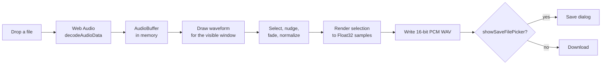

# Architecture

GitTrim is one HTML file with inline CSS and JavaScript. This page explains how it works and why it's built this way.

## Flow

## Layout

| Path | Role |
| --- | --- |
| `index.html` | **The whole app.** Markup, styles and script. Served as-is by GitHub Pages. |
| `scripts/check.mjs` | CI check: the script parses, and the page has no network calls or external resources. |
| `docs/` | This page. |

## Design decisions

**One file, no dependencies.** The tool has to work by double-clicking a downloaded file, offline, years from now. A single HTML file with no build step, CDN or package does that, and GitHub Pages can serve the same file unchanged.

**Decode with the browser.** `AudioContext.decodeAudioData` reads whatever the browser can play, including the audio track of mp4 and webm video. That covers the common formats without shipping a decoder, at the cost that support varies slightly by browser.

**Draw from the samples.** The waveform is redrawn from the raw channel data for just the visible window, one min/max pair per pixel column, so zooming stays sharp at any level rather than stretching a pre-rendered image. Long columns are sampled with a stride to keep redraws fast.

**Process at export, not on edit.** Fades and normalization are applied to a copy of the selected samples when you preview or export. The original buffer is never modified, so every setting can be changed freely.

**WAV only.** Browsers can't encode mp3 or ogg without a bundled encoder. WAV is simple enough to write in a few lines, and every OS plays it with built-in tools. Export keeps the source sample rate and channel count and writes 16-bit PCM.

**Save dialog when available.** Chrome and Edge support `showSaveFilePicker`, so you choose where the file goes. Other browsers fall back to a normal download.

**Nothing leaves the browser.** The page makes no network requests and loads no external resources. `scripts/check.mjs` fails CI if a change adds any, so "nothing is uploaded" stays true.
